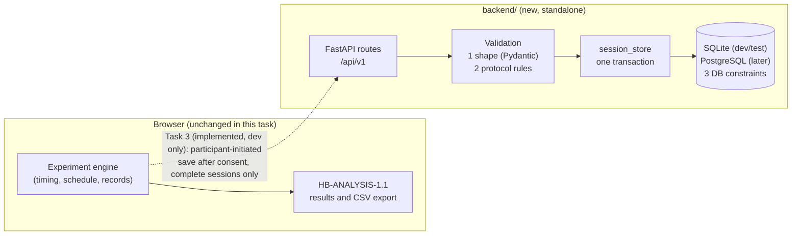
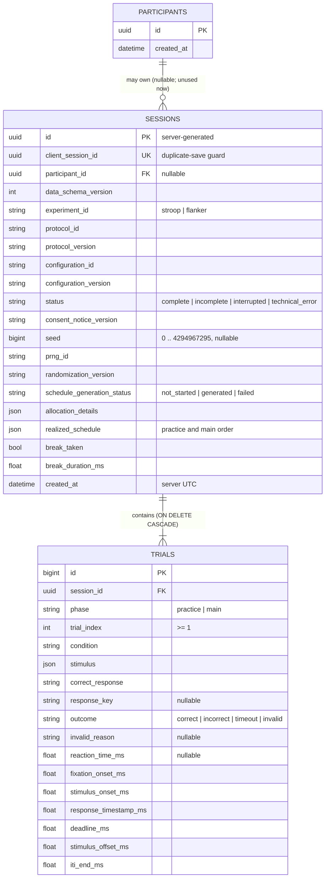

# HUMAN BENCHMARK — Backend Architecture (Cycle 8, Tasks 1+2)

**Status:**
- Tasks 1+2 are implemented.
- Tasks 3+4 are implemented and audited, awaiting project-owner review.
- Frontend saving is a **local development and test flow only**, under a
  **provisional, unapproved** notice (frontend/PERSISTENCE_INTEGRATION.md).
- Cycle 8 is not approved, and the backend is not deployable (§9).

Related documents:
- [ADR-001: backend stack](../decisions/ADR-001-backend-stack.md);
- [DATA_AND_PRIVACY.md](DATA_AND_PRIVACY.md);
- [API.md](API.md);
- [backend/README.md](../../backend/README.md) (setup and commands).

## 1. Scope: now versus deferred

| Implemented in Tasks 1+2 | Deferred |
| --- | --- |
| FastAPI app, typed configuration, SQLite connection management | An approved consent notice and real participant collection |
| Schema: `participants`, `sessions`, `trials`, with Alembic migration `0001` | Participant endpoints and ownership proof for reading or deleting (Cycle 9, before any deployment) |
| Validation: request shape, protocol rules and database constraints | Participant-facing viewing and deletion |
| **Task 3:** frontend save panel (opt-in, consent, safe retry), mapping, complete-only rule | |
| `GET /api/v1/health` | Retention purge job (decision in DATA_AND_PRIVACY.md §6) |
| `POST /api/v1/sessions` (atomic session + trials) | Live PostgreSQL run, deployment, HTTPS, rate limiting (Cycle 10) |
| `GET` and `DELETE /api/v1/sessions/{id}` (local development only) | Observatory UI (Cycle 9 Tasks 9.3–9.4) |
| **Cycle 9 Task 9.2:** local-owner scope (`app/scope.py`, development + `HB_LOCAL_OWNER_ACCESS=true`), `GET /api/v1/sessions` summaries with keyset pagination, `DELETE /api/v1/sessions` with confirmation, Host allowlist, SQLite `secure_delete` | Ownership proof (participant key) before any deployment |
| Error envelope, request-size limit, CORS, privacy-safe logging | Server-side analysis |
| Automated tests (isolated databases) | |

## 2. Architecture overview



**Boundaries:**
- **The browser owns everything time-critical.** Timing, scheduling, response
  handling and analysis stay in the frontend. The backend never takes part
  during a trial; a save happens only after the session has ended.
- **The backend stores raw records and checks them.** It does not compute
  results, and it does not change, round or "fix" values. Anything that fails a
  check is rejected as a whole.
- **The dotted arrow is the only network call** (Task 3): one POST from the
  results page of a complete session, only after explicit agreement, only in a
  dev-server build pointed at this computer. It never happens during trials.

## 3. Directory structure

```text
backend/
  README.md                 setup, run, test, migration commands
  pyproject.toml            project metadata + ruff / mypy / pytest settings
  requirements.txt          pinned runtime dependencies
  requirements-dev.txt      pinned test and tooling dependencies
  .env.example              documented settings (no secrets)
  alembic.ini               Alembic settings (no database URL in this file)
  migrations/
    env.py                  reads the URL from app settings
    versions/0001_initial_schema.py
  app/
    __main__.py             `python -m app`: runs Uvicorn with safe defaults
    main.py                 create_app(): middleware, routers, error handlers
    config.py               Settings (HB_* environment variables)
    database.py             engine, sessions, SQLite foreign-key pragma
    models.py               SQLAlchemy tables and DB constraints
    schemas.py              Pydantic request and response models (layer 1)
    protocols.py            approved protocol facts per experiment
    validation.py           cross-field and protocol rules (layer 2)
    session_store.py        transactional create / read / list / delete, keyset cursors
    scope.py                local-owner scope for every read and delete (Cycle 9)
    errors.py               error envelope and exception handlers
    middleware.py           request-size limit, privacy-safe request log
    routes/health.py, routes/sessions.py
  tests/                    pytest suite (temporary SQLite per test)
```

## 4. Key design decisions

1. **Raw records are the single source of truth.** The backend stores trials as
   the engine recorded them. It stores **no** medians, rates or contrasts. If it
   did, they could contradict the trials, and a second (Python) analysis
   implementation could drift from `HB-ANALYSIS-1.1`. Any result is recomputed
   from the trials with an explicitly versioned analysis. This is also why
   `analysis_version` is not a session column: it describes a calculation, not
   the data.
2. **Anonymous by default.** There is a `participants` table and a nullable
   `sessions.participant_id`, so Cycle 9 does not need a redesign. But no
   endpoint creates participants, and the API does not accept a participant ID.
   Every session saved by this foundation is unlinked. Linking requires a
   consent decision (DATA_AND_PRIVACY.md §4).
3. **The server chooses session IDs.** `sessions.id` is a server-generated UUIDv4.
   The client sends `client_session_id`, a random UUID with a unique constraint.
   It exists only to block duplicate saves (for example a network retry); a
   duplicate gets 409.
   - The frontend's existing `sessionId` is not trusted as a key: its fallback,
     `session-<time>`, is guessable and not unique.
4. **Server time only.** `created_at` is the server's UTC time of saving. No
   client clock time or time zone is stored. Trial timestamps stay as the
   browser's relative `performance.now()` values, as in the CSV export.
5. **The realized schedule is stored.** Approved protocols (Stroop §7, Flanker
   §8, data conventions §6) require the realized practice and main order to be
   kept, because a seed alone is not enough. The schedule is stored as JSON on
   the session, and every recorded trial is checked against its planned entry.
6. **Consent is a required field now, with no UI yet.** A save must include
   `consent: {"confirmed": true, "notice_version": "..."}`. The server will not
   store a session without an explicit affirmation and the notice version it
   refers to. The version must be on the allowlist in `app/consent.py`. The only
   entry, `HB-NOTICE-0.1-PROVISIONAL`, is a development and test placeholder,
   **not approved for real participant data**.
7. **Deletion is a hard delete.** `DELETE` removes the session row, and
   `ON DELETE CASCADE` removes its trials in the same transaction. There is no
   soft delete or tombstone.
8. **Start-up refuses deployment settings.** `HB_ENV` accepts only `development`
   or `test`. Any other value stops start-up, because read and delete have no
   ownership proof yet (§9).

## 5. Database design



**Relationships and keys:**
- One session has 0–72 trials: `trials.session_id` references `sessions.id`
  (`NOT NULL`, `ON DELETE CASCADE`).
- `UNIQUE (session_id, phase, trial_index)` makes a duplicate trial index
  impossible.
- `sessions.participant_id` references `participants.id` (nullable,
  `ON DELETE CASCADE`), so deleting a participant would later delete all their
  sessions.

**Why some fields are typed columns and some are JSON:**
- Fields that need constraints or queries are typed columns: outcome, RT,
  condition, phase and status.
- The stimulus (`{word, ink_color}` for Stroop; `{target_direction,
  flanker_type, symbols}` for Flanker) differs per experiment. It is stored as
  JSON *after* strict per-experiment validation. That way a new experiment does
  not require nullable columns for every other experiment's attributes.

**Indexes for likely Cycle 9 queries:**
- `(participant_id, created_at)`: one participant's sessions by date;
- `(experiment_id, created_at)`: sessions by experiment and date;
- the unique trial index above, which doubles as the lookup for a session's
  trials.

**Columns that are deliberately absent:**
- name, email or contact details;
- IP address, user agent, screen size, time zone or locale;
- the engine's `sessionId`;
- stimulus presentation constants (fonts, colors and sizes, which are fixed by
  `protocol_id`);
- `trialEndMs`, `trialDurationMs` and `timingSource` (not exported and not used
  by any analysis);
- derived results.

## 6. Validation strategy: three layers

1. **Shape (Pydantic, `schemas.py`).**
   - **Strict types:** no `"12"` for `12` and no `1` for `true`.
   - **`extra="forbid"` on every object**, so an unexpected field (for example
     `email`) is rejected rather than silently dropped. This is what makes "no
     identifiers by default" enforceable.
   - **Values:** allowed values via `Literal`, finite numbers only (`NaN` and
     `Infinity` rejected), and bounded string lengths, list lengths and number
     ranges.
2. **Protocol and consistency rules (`validation.py` with `protocols.py`).** These
   are pure functions that return every problem found, each with its location.
   - **Identity:** experiment, protocol, configuration and PRNG IDs must be an
     approved combination.
   - **Schedule:** if generated, practice has 12 and main 60 entries, indexed 1..N
     in order. Each entry's condition and correct key are consistent with its
     stimulus, and the condition counts match the protocol (practice 4/4/4, main
     20/20/20).
   - **Stimulus:** strict per experiment.
     - Stroop: a congruent word names its ink color, an incongruent color word
       names a different color, and a neutral trial uses a neutral word.
     - Flanker: the flanker type matches the condition, and the five symbols
       match the target and flankers.
   - **Trials:** every trial equals its planned schedule entry. Outcome, response
     key and RT must agree:
     - a correct or incorrect trial has a response key and an RT;
     - a timeout or invalid trial has neither;
     - a correct trial's key equals the correct key;
     - an incorrect trial's key is a different mapped key;
     - an invalid trial has a reason, and no other outcome has one.
   - **RT and timing:**
     - RT must be at least 0 and below the 2,000 ms deadline;
     - RT equals response time minus stimulus onset (±0.001 ms);
     - deadline equals onset + 2,000 ms;
     - the timestamps are in order: fixation ≤ onset, onset ≤ stimulus offset ≤
       ITI end.
   - **Session completeness:**
     - each phase's recorded trials are 1..k with no gaps or duplicates;
     - main trials require a complete practice phase;
     - `complete` requires 12 + 60 trials;
     - trials require a generated schedule;
     - a break duration requires at least 30 main trials, and `break_taken`
       requires a duration.
   - **Seed and consent:** a generated schedule requires a seed, and consent must
     be `true`.
3. **Database constraints (`models.py`, migration `0001`).** These are the last
   line of defense if code bypasses the API:
   - CHECKs on every enumerated value;
   - RT ≥ 0;
   - seed range;
   - outcome, response and RT agreement;
   - invalid reason present exactly when the outcome is invalid;
   - correct key equality;
   - `NOT NULL`, FK and UNIQUE constraints.

   JSON columns use `none_as_null=True`. Without it, SQLAlchemy would store a
   missing value as the JSON value `null`, which slips past `NOT NULL`. Tests
   insert bad rows directly to prove these hold, and mutation checks (each
   safeguard disabled in turn) confirmed the tests fail when a safeguard is
   removed.

**Assumptions** (verified against `frontend/src/engine` in this task):
- trial indices are 1-based within each phase;
- the engine never records an RT for timeouts or invalid trials, and never
  records a response for them;
- a response whose RT cannot be computed becomes an invalid `timing_error`, so
  correct and incorrect trials always carry an RT;
- a `technical_error` can happen mid-session, so such sessions may contain
  trials;
- `stimulus_offset_ms` may be up to one frame before `response_timestamp_ms`
  (EXPORT_DATA_DICTIONARY.md), so they are not ordered against each other.

## 7. API contract (summary)

Full payloads are in [API.md](API.md). URL versioning uses `/api/v1`. A breaking
change gets `/api/v2`; additive optional fields stay in v1. The payload carries
`data_schema_version` (currently `1`), so stored rows record which contract they
arrived under.

| Method and path | Purpose | Success | Errors |
| --- | --- | --- | --- |
| `GET /api/v1/health` | Process up, database reachable, schema at the latest migration | 200 | 503 |
| `POST /api/v1/sessions` | Store one session and all its trials atomically | 201 | 409, 413, 422 |
| `GET /api/v1/sessions/{id}` | Read a stored session (local development only) | 200 | 404, 422 |
| `DELETE /api/v1/sessions/{id}` | Hard-delete a session and its trials (local development only) | 204 | 404, 422 |

## 8. Error handling

Every error has the same envelope:

```json
{ "error": { "code": "invalid_session", "message": "…", "details": [ { "location": "trials[3].reaction_time_ms", "message": "…" } ] } }
```

| Code | HTTP | When |
| --- | --- | --- |
| `invalid_request` | 422 | Malformed JSON, wrong types, unknown fields, out-of-range values |
| `invalid_session` | 422 | Well-formed but breaks a protocol or consistency rule |
| `duplicate_session` | 409 | `client_session_id` already stored |
| `not_found` | 404 | Unknown session ID or route |
| `method_not_allowed` | 405 | Method not supported on that route |
| `payload_too_large` | 413 | Body over `HB_MAX_REQUEST_BYTES` (default 256 KiB) |
| `service_unavailable` | 503 | Health check failed |
| `internal_error` | 500 | Anything unexpected. A generic message; no stack trace, SQL or values |

**Details never echo submitted values.** Pydantic's `input` field is removed, so
participant data is not reflected back or logged.

## 9. Security considerations

The **foundation level** is implemented:
- every input is validated, as described in §6;
- request size is limited, with 413 returned before parsing;
- list and string lengths are bounded;
- responses are generic 500s, with `debug` off;
- SQLAlchemy `hide_parameters=True`, so database errors never contain values;
- unexpected errors are logged server-side with their type, route and
  traceback. Tracebacks show code, not local variables, but an exception
  message written by future code could contain a value. Keep exception messages
  free of participant data;
- no telemetry: `opentelemetry-api` (required by FastAPI) is inert without an
  SDK, and none is installed;
- request logs record only method, path template, status and duration (no
  body, query string or client IP), and the Uvicorn access log is disabled;
- CORS is an explicit allow-list (default `http://localhost:5173` and
  `http://127.0.0.1:5173`). `*` is rejected at start-up, methods are limited to
  GET, POST and DELETE, and there are no credentials;
- the default bind is `127.0.0.1`;
- *(Cycle 9 Task 9.2)* **Host allowlist:** Starlette `TrustedHostMiddleware`
  accepts only `localhost` and `127.0.0.1` on any port. Everything else gets
  400, which blocks DNS rebinding. It is the outermost check after the request
  log;
- *(Cycle 9 Task 9.2)* **Local-owner scope:** every endpoint that reads or
  deletes stored sessions depends on `require_owner_scope`, and every store
  query is filtered through `OwnerScope`.
  - The routes are registered only when `HB_ENV=development` and
    `HB_LOCAL_OWNER_ACCESS=true`, and the live settings are re-checked on
    each request.
  - This is **not** ownership proof. Item 1 below still applies;
- *(Cycle 9 Task 9.2)* **SQLite `secure_delete=ON`** on every connection.
  Limits are in DATA_AND_PRIVACY.md §8.2;
- there are no credentials in code. The database URL comes from the environment
  or `.env`; `.env` and `*.db` files are git-ignored;
- all queries go through the ORM, which uses bound parameters.

**Before any deployment, all of the following are required** (tracked in §12):
1. **Ownership proof** for reading and deleting. With local-owner access on
   (development only), anyone who can reach the local server can list, read
   and delete **every** session. With it off, nothing can be read or deleted
   through the API.
   - **Recommendation:** a random participant key held only by the browser,
     stored server-side as a hash (DATA_AND_PRIVACY.md §4).
2. **HTTPS, rate limiting** and abuse protection on `POST`.
3. **A live PostgreSQL test run,** with a least-privilege database user and the
   connection string kept in the host's secret store.
4. **Deployment settings:** a production CORS origin, and a security headers
   review.
5. **Backups** with retention that matches the deletion promise.
6. **A dependency audit** in CI.

## 10. Migration strategy

- **The schema exists only through Alembic.** The app never calls `create_all`.
  Running `alembic upgrade head` is a documented set-up step, and the health
  check reports `schema_not_current` until it has been run.
- **Writing migrations:** one migration per change, reviewed by hand (autogenerate
  is a starting point only). Batch mode (`render_as_batch`) lets later
  migrations alter SQLite tables.
- **Constraint names** come from a naming convention in `models.py`. Inside a
  migration, a CHECK name must be wrapped in `op.f(...)`; otherwise the
  convention is applied twice (`ck_trials_ck_trials_phase`). A test compares
  every stored constraint name with the models.
- **Tests:**
  - upgrade an empty database, then downgrade back to empty;
  - compare the migrated schema with `models.py` (no differences allowed);
  - render the PostgreSQL SQL offline.
- **Changing stored data later:** a change to the stored contract bumps
  `data_schema_version`; rows keep the version they were stored with.

## 11. Future Cycle 9 compatibility

| Cycle 9 need | How the schema supports it, with no redesign |
| --- | --- |
| A participant's saved sessions | `sessions.participant_id` and an index on `(participant_id, created_at)` |
| Sessions by experiment and date | `experiment_id`, `created_at` and the matching index |
| Historical summaries | Recompute from `trials` with a versioned analysis. At 72 rows per session this is cheap. A cache table can be added later and kept consistent from raw data |
| Trial-level data | Typed `trials` columns: condition, outcome, RT, phase |
| Comparing sessions | `protocol_id` and `configuration_version` on every session, so sessions run under different protocol versions are never compared silently |
| Longitudinal plots | `created_at` (server UTC) orders sessions |

Not built: dashboards, rankings, norms, recommendations or inference.

## 12. Implementation roadmap

| Step | Content | State |
| --- | --- | --- |
| Task 1 | This design, ADR-001, DATA_AND_PRIVACY.md, API.md | Done |
| Task 2 | The backend foundation in §3, with tests | Done (Cycle 8 approved with conditions) |
| Task 3 | Frontend mapping, opt-in save panel with the provisional notice, safe retry, complete-only rule. Participant key and UI deletion deferred to Cycle 9 | Done (Cycle 8 approved with conditions) |
| Task 4 | End-to-end audit: real browser, real API and database, privacy review, development-only deletion demonstrated. Live PostgreSQL run prepared (`HB_TEST_POSTGRES_URL`) but **not run** (needs credentials) | Done (Cycle 8 approved with conditions) |
| Cycle 9, Task 9.2 | Local-owner scope, Host allowlist, session list, delete-all, `secure_delete` (API.md) | Done (awaiting review) |
| Cycle 10 | Deployment hardening (§9) | Not started |
