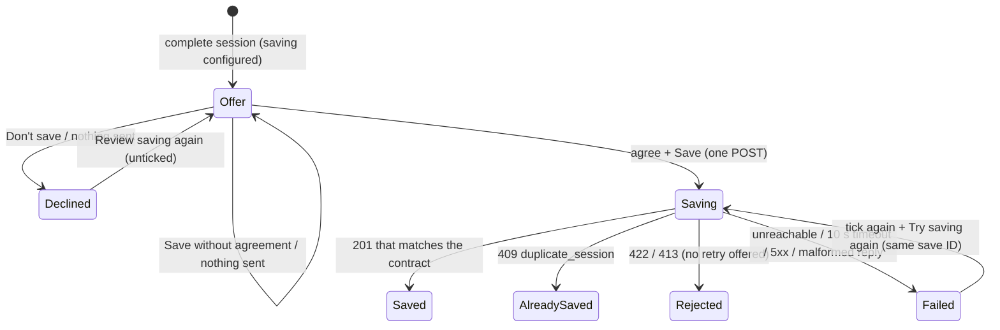

# HUMAN BENCHMARK — Saving a Session (Cycle 8, Tasks 3+4)

**Status:** implemented as a **local development and test data flow only**.
Awaiting project-owner review. **It is not an approved data-collection system.**
The consent notice it shows, `HB-NOTICE-0.1-PROVISIONAL`, is a provisional draft:

- the notice has not been approved;
- there is no ethics or research approval;
- it must not be used to collect real participant data.

Related: [docs/backend/API.md](../docs/backend/API.md),
[DATA_AND_PRIVACY.md](../docs/backend/DATA_AND_PRIVACY.md),
[BACKEND_ARCHITECTURE.md](../docs/backend/BACKEND_ARCHITECTURE.md).

## 1. What a participant sees

After a **complete** Stroop or Flanker session, the results page shows an
optional **"Save this session (optional)"** panel below "Your data". It is
labeled "Development test · provisional notice" and states:

- **Provisional status:** the notice is provisional, has not been approved, and
  there is no ethics or research approval; save only your own test sessions;
- **What would be saved** and **what is not stored** (§3);
- **Where it goes:** only the test server on this computer, until the person
  running it deletes it;
- **Viewing and deleting:** neither is available from the page yet (§7).

Nothing is sent until the participant ticks **"I have read this provisional
notice, and I agree to save this session to the local test server."** and then
presses **Save this session**.

- **Without the tick:** pressing Save shows "Nothing has been sent" and moves
  focus to the checkbox. What counts is the checkbox actually on the page at
  the moment Save is pressed, together with the panel's own agreement state;
  both must be ticked (§2, "Consent boundary").
- **One tick, one attempt:** the agreement is cleared as soon as an attempt
  starts. If it fails, the checkbox is shown again, unticked, and "Try saving
  again" needs a fresh tick.
- **Don't save:** shows "Not saved. Nothing from this session was sent." Choosing
  "Review saving again" starts with the box unticked, so agreement is never
  remembered.

For a session that was **not completed** (exited, interrupted, technical error),
the panel shows only "Only complete sessions can be saved…", with no checkbox
or button.

When saving is not configured (§5), the panel does not exist at all, and the
results page is exactly as in Cycle 7. When it is configured, one sentence of
the CSV text changes to stay accurate: "Nothing is stored by HUMAN BENCHMARK
unless you choose to save the session below".

## 2. Flow and safety properties



- **Consent boundary (two layers).** `persistence/consent.ts` issues a
  single-use authorization only when both the agreement state and the live
  checkbox on the page are ticked at the moment of the click. `saveSession`
  throws before any network activity unless it receives an authorization that
  was issued there, has not been used, and matches the payload's notice
  version. Authorizations cannot be constructed elsewhere (module-private
  `WeakSet`).
- **No network during the experiment.** The request is built and sent only
  from the results page, after the engine has finished. The engine, timing,
  schedule and response code are unchanged (§8).
- **One request per click; no double submission.** While saving, the button
  is disabled and an in-flight guard ignores further clicks (tested with three
  rapid clicks).
- **Safe retry (idempotency).** A retry needs a fresh tick (above). One random save ID (`client_session_id`,
  `crypto.randomUUID()`) is created per session and reused on every retry. The
  backend stores a save ID only once and answers a repeat with 409. If the first
  attempt was stored but its reply was lost (for example a timeout), the retry
  reports **"Already saved"**, not a second copy. No backend change was needed.
- **A save is confirmed only by a matching 201:** the body must name the
  same experiment and status and carry valid trial counts. Anything else is
  "Save not confirmed".
- **Server text is never shown.** Each reply is reduced to a fixed,
  plain-language message.
- **Leaving the page aborts the request,** and the panel is not updated
  afterwards.
- **Focus and announcements:** after each step, focus moves to the status area,
  which contains `role="status"` or `role="alert"` messages.
- **No secure random source** (`crypto.randomUUID` missing): the panel says
  saving is unavailable, and nothing is sent. There is no weaker fallback ID.

| Outcome                         | Message                                                                 | Retry offered           |
| ------------------------------- | ----------------------------------------------------------------------- | ----------------------- |
| 201 matching the contract       | Session saved: N trials (P practice, M main), as reported by the server | No (finished)           |
| 409 `duplicate_session`         | Already saved (not stored twice)                                        | No                      |
| 422 at `consent.notice_version` | The server does not recognize this notice version                       | No                      |
| Other 422, 413                  | The server found a problem with the data / too large                    | No                      |
| Network error                   | Could not reach the test server                                         | Yes, after a fresh tick |
| 10 s timeout                    | No answer; may or may not have been stored                              | Yes, after a fresh tick |
| 5xx                             | The test server had a problem                                           | Yes, after a fresh tick |
| Malformed or unexpected reply   | Save not confirmed                                                      | Yes, after a fresh tick |

In every failure the results, plot, tables and CSV download stay on the page.

## 3. What is transmitted, and what stays local

**Transmitted** (only on an explicit save; `data_schema_version` 1; the full
contract is in API.md):

- experiment, protocol and configuration IDs and versions;
- `status: "complete"`;
- the break taken and its duration;
- the seed, PRNG ID, randomization version, allocation details, and the
  realized practice and main order;
- every recorded trial: phase, index, condition, task-relevant stimulus
  (Stroop `word`, `ink_color`; Flanker `target_direction`, `flanker_type`,
  `symbols`), correct key, pressed key or none, outcome, invalid reason, RT, and
  the six timestamps already in the CSV export;
- `consent: {confirmed: true, notice_version: "HB-NOTICE-0.1-PROVISIONAL"}` and
  the random save ID.

**Never transmitted:**

- the engine's `sessionId` and `trialId`;
- response metadata (`inputSource`, `accepted`);
- `trialEndMs`, `trialDurationMs` and `timingSource`;
- presentation constants (hex colors, fonts, sizes, background);
- the five-cell array object;
- any computed results (rates, medians, contrasts, plot data);
- any name, email, account, or device or browser field.

Tests check this key by key, and with a sentinel engine session ID that must
never appear.

**Sent by the browser itself.** Like any request, the browser adds standard
headers: `User-Agent`, `sec-ch-ua*`, `Accept-Language` and `Origin`. These were
verified with a real listener (§9). The backend reads only `Content-Length` and
stores and logs none of them. **No `Referer` and no cookies** are sent: the
request uses `referrerPolicy: "no-referrer"` and `credentials: "omit"`, also
verified. The connection itself reveals the client address (`127.0.0.1` here),
which is not stored, and the documented server command does not log it.

**Stays local:** the results page, all calculations, and the CSV download
(unchanged), whether or not the session is saved.

## 4. Mapping (frontend record → API)

- `persistence/sessionPayload.ts`: `saveEligibility` and
  `buildSessionSavePayload`. These are pure functions that pass values through
  as recorded, with no rounding.
- Experiment adapters choose which stimulus attributes to send:
  `stroopStimulusToApi` (`stroop/stroopResultsFormat.ts`) and
  `flankerStimulusToApi` (`flanker/flankerResultsCopy.ts`).
- **Eligibility** comes from the engine's own completion status: only
  `status === "complete"`. The backend enforces the same rule. The records must
  also come from one session: the same experiment, protocol and seed, with a
  generated schedule.

**Cross-stack contract.** Four committed fixtures in
`persistence/__fixtures__/` are written by the frontend mapping:

- two from the real schedule generators;
- two captured from **full sessions run through the real engine and pages**.

Frontend tests check that the mapping still produces them byte for byte.
`backend/tests/test_frontend_contract.py` posts all four to the real validation
and expects 201 and an exact round trip.

## 5. Enabling it (local development only)

Saving is offered only when **all** of these are true. The rules are enforced in
`persistence/saveConfig.ts`:

1. **A dev-server build** (`import.meta.env.DEV`). A production build
   (`npm run build`) never offers saving, whatever its configuration.
2. **`VITE_HB_LOCAL_SAVE_API` is set**, for example
   `http://127.0.0.1:8000`.
3. **That address is this computer, in a form the backend accepts:**
   `http://127.0.0.1[:port]` or `http://localhost[:port]`, a plain origin with
   no credentials, path or query. Any other address disables saving, so
   configuration cannot send data to another machine. Since Cycle 9 Task 9.4,
   `[::1]` and `https:` are refused, because the backend's Host allowlist and
   plain-HTTP server would reject them; the rule is shared with the
   Observatory (`src/experiments/shared/localApi.ts`).

```powershell
# Terminal 1: backend (see backend/README.md for first-time setup)
cd backend
.\.venv\Scripts\python -m alembic upgrade head
.\.venv\Scripts\python -m app

# Terminal 2: frontend with saving switched on
cd frontend
$env:VITE_HB_LOCAL_SAVE_API = "http://127.0.0.1:8000"
npm run dev        # http://localhost:5173 (the backend's default CORS origin)
```

**Why this is the separation between test and real collection.** Real
collection would need all of the following, and none of it can be switched on by
configuration:

- an approved notice listed in the backend allowlist;
- the deployment requirements in BACKEND_ARCHITECTURE.md §9;
- a reviewed code change, because the `DEV` and loopback rules are in code.

The backend also refuses to start with any `HB_ENV` other than `development` or
`test`.

## 6. Participant identity (deferred to Cycle 9)

No participant key is created. Single-session saving does not need one, and a
key must not be added before its consent and ownership design is approved.
Every saved session has `participant_id` NULL.

The Cycle 9 implications are in DATA_AND_PRIVACY.md §4: a pseudonymous key held
by the browser and stored as a hash on the server. Sessions saved now cannot be
linked to a person later, and that is intended.

## 7. Viewing and deletion (not offered)

The backend's `GET` and `DELETE /api/v1/sessions/{id}` have **no ownership
proof**. A session ID is not an authorization credential, so the page does not
use them. It does not keep or show the returned session ID, and says plainly
that viewing and deleting are not available yet.

In this development setup, a saved session stays in the local database file
until the person running the server deletes it. They can do that with the
development `DELETE` endpoints (`/docs`), or by deleting the database file.
Since Cycle 9 Task 9.2, those endpoints exist only when the backend runs with
`HB_LOCAL_OWNER_ACCESS=true` in development (backend/README.md).
There is no automatic retention limit yet (DATA_AND_PRIVACY.md R6).

## 8. Scientific integrity

**No file changed in:**

- the engine;
- the protocols;
- the schedules and randomization;
- the session hook and shell;
- the analysis, plot and CSV export.

The only changes in experiment code are on the two results pages, which pass
the already-recorded snapshot (`status`, `records`, `breakTaken`,
`breakDurationMs`) to the panel. That data is built only after the session has
ended. The full previous test suite passes unchanged.

## 9. Verification (summary; see the Cycle 8 Task 3+4 report)

- **Unit and component tests:**
  - `sessionPayload.test.ts` (mapping, eligibility, no forbidden fields, fixtures);
  - `saveConfig.test.ts` (production off, loopback only);
  - `saveSessionClient.test.ts` (every HTTP outcome, timeout, cancellation);
  - `SaveSessionPanel.test.tsx` (consent, decline, retry with the same ID,
    double click, rejections, focus, unmount);
  - `sessionResultsSave.test.tsx` (unchanged page when not configured).
- **Page tests:** `experimentSave.test.tsx` runs full sessions through the real
  pages and engine.
- **Scripted browser run:** real headless Edge, Vite and the backend, keyboard
  only. Scenarios:
  - backend down, then retry;
  - decline, then save;
  - an incomplete session;
  - 1280, 390 and 320 px widths;
  - the request log and the real database inspected.

  This was not human testing.

## 10. Consent incident during manual testing (Cycle 8)

During the project owner's manual check, one Flanker session was reported
stored after Save was pressed with the agreement box seen as unticked.

- **Stored:** one complete Flanker session (72 trials) in the local
  development SQLite file only, with `participant_id` NULL and the provisional
  notice version. It was kept unchanged as evidence.
- **Not reproduced:** in a real browser, every path tried with the box
  unticked sent no request. The exact cause is not proven.
- **Fixed regardless:** the weaknesses that would have allowed it are closed.
  Consent was checked in one place only, against React state rather than the
  checkbox on the page, and it survived a failed attempt. See §2,
  "Consent boundary", and the regression tests in `SaveSessionPanel.test.tsx`
  and `saveSessionClient.test.ts`.
- **Trust limitation:** the backend receives only a client-asserted
  `consent.confirmed: true`. This protects the participant's own browser
  flow; it is not proof of consent.
